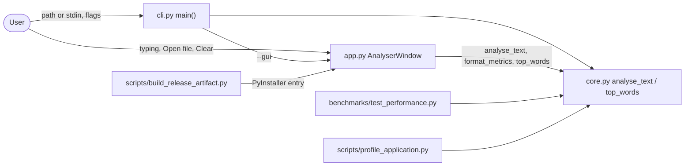

# repo-quality-template — documentation hub

`repo-quality-template` has two parts. The first is a small Python package,
`quality_template` (shown to users as "Text Analyser"). It reports statistics for
a piece of text: characters, words, unique words, sentences, average word length,
lexical diversity, longest word and the most frequent words. It runs from the
command line or in a tkinter window. The second part is a reference repository
layout: CI, tests, benchmarks, an ISO/IEC 25010 assessment, branch and
contribution policies, release packaging, and a script that copies that layout
into another repository. The package docstring says the application exists so
that "every quality control in this repository has something concrete to act
on" (`src/quality_template/__init__.py:1-6`). The repository does not say who the
intended users are. See [Open questions in SPEC.md](../SPEC.md#9-open-questions).

The requirements specification reverse-engineered from the code is
[`SPEC.md`](../SPEC.md).

## 1. Status

| Item | State | Source |
| --- | --- | --- |
| Documented commit | `d74be72`, 2026-09-06 15:44:45 +0300, "Merge pull request #6 … rqt-5/docs/issue-closing-rule" | `git log -1` |
| History | 26 commits reachable from `d74be72`, first one dated 2026-08-01 | `git log` |
| Package version | `1.0.0` | `pyproject.toml:7`, `src/quality_template/__init__.py:11` |
| Tags | `v1.0.0` and `v1.0.1` (2026-08-01) are in the history of `d74be72`. `v1.1.0` (2026-11-08) exists only on `release`. Two more lightweight tags, `import/dev` and `import/rqt-7/fix/branch-classification`, point at the tips of those branches | `git for-each-ref refs/tags` |
| Tests | 44 test cases under `tests/` (25 core, 8 CLI, 11 desktop) and 5 benchmark cases under `benchmarks/` | `pytest --collect-only`, `tests/test_app.py` |
| CI | 4 GitHub Actions workflows: `ci.yml`, `branch-policy.yml`, `contribution-policy.yml`, `release.yml`, plus Dependabot | `.github/` |
| TODO / FIXME / XXX / HACK markers | 0 | search over the tracked files |
| Open work named by the author | `release_notes_vulns`, `know_secure_design`, `know_common_errors` | `docs/decisions.md:106-119` |

Branch state. This checkout is `origin/dev` at `d74be72`. `origin/release`
contains all of `d74be72` plus 21 further commits. Those 21 commits
restructure the repository: `.github/` moves under `template/`, and the commits
add `recipe.ps1` and `uv.lock` and delete `requirements-dev.lock`
(`git diff --stat HEAD origin/release`). The branch
`origin/rqt-7/fix/branch-classification` (3 commits) is not merged into `dev`.
This hub and `SPEC.md` describe `d74be72` only.

## 2. Layout

| Path | What it is |
| --- | --- |
| `src/quality_template/core.py` | Domain layer: tokenising, sentence counting, `analyse_text`, `top_words`, `format_metrics`. Standard library only |
| `src/quality_template/cli.py` | Command-line shell. Entry point `quality-template` (`pyproject.toml:33-34`) |
| `src/quality_template/app.py` | tkinter desktop window `AnalyserWindow`, `run_app()` |
| `src/quality_template/__init__.py` | `__all__` = `TextStats`, `analyse_text`, `top_words`; also defines `__version__` |
| `tests/` | pytest suites for core, CLI and desktop window |
| `benchmarks/test_performance.py` | pytest-benchmark cases for `analyse_text`, `tokenise`, `top_words` |
| `scripts/install_dependencies.py` | Installs the package. Can also install the dev tools, install from the lock, or regenerate the lock |
| `scripts/check_before_push.py` | Runs, on the local machine, the ruff/mypy/pytest commands it finds in `.github/workflows`. Can install a git pre-push hook |
| `scripts/enforce_branch_policy.py` | Checks branch names: `release`/`dev`/`test` plus `<code>-<issue>/<type>/<slug>` work branches |
| `scripts/enforce_contribution_policy.py` | Checks the branch name, commit subjects, sign-off and that the PR body closes an issue |
| `scripts/collect_quality_metrics.py` | Four ISO/IEC 25010 scores (tests, coverage, maintainability, portability) |
| `scripts/build_release_artifact.py` | PyInstaller single-file build, zip and `.sha256` files under `release/` |
| `scripts/generate_sbom.py` | CycloneDX 1.5 SBOM built from `requirements-dev.lock` |
| `scripts/profile_application.py` | cProfile run over the domain functions |
| `scripts/capture_usage_screenshots.py` | Regenerates `docs/screenshots/*.png` (GUI capture is Windows only) |
| `scripts/apply_template_to_repo.py` | Copies the layout into another repository and prints a 24-point report |
| `scripts/audit_workflow_hazards.py` | Scans git mirrors under `scripts/_secret_scan/` for four CI hazards. That directory is not in the repository |
| `.github/workflows/` | CI, branch policy, contribution policy, release |
| `.github/ISSUE_TEMPLATE/`, `.github/PULL_REQUEST_TEMPLATE.md`, `.github/CODEOWNERS`, `.github/dependabot.yml` | Contribution shape and dependency monitoring |
| `pyproject.toml` | Package metadata and the config for ruff, mypy, pytest and coverage. Also `[tool.repo-quality]`, the branch and commit vocabulary |
| `requirements-dev.lock` | 33 exact pins that CI installs |
| `.pre-commit-config.yaml` | pre-commit hooks: whitespace, YAML/TOML, private keys, ruff, gitleaks |
| `docs/` | Architecture, branching, workflow, ISO 25010 assessment, decisions, standards comparison, screenshots, `sample.txt` |

## 3. Architecture

There are three layers, and dependencies point one way: `cli.py` and `app.py`
call `core.py`, and `core.py` imports only `re`, `collections` and `dataclasses`
(`src/quality_template/core.py:9-13`). `cli.py` imports `app.py` lazily, and only
when `--gui` is given (`src/quality_template/cli.py:67-70`). The release build
packages `app.py` as its entry point (`scripts/build_release_artifact.py:28`).
The full reasoning is in [`architecture.md`](architecture.md).



Data flow. A shell obtains text from a file, stdin or the text widget.
`analyse_text` tokenises once and returns a frozen `TextStats` that carries the
word `Counter`. `top_words` filters and ranks that counter without re-reading the
text (`src/quality_template/core.py:110-170`).

External systems. The package itself opens no network connection and does not
read the environment: no `os.environ` or `getenv` appears under `src/`. The
tooling talks to:

- git, through the policy scripts, `generate_sbom.py` and `audit_workflow_hazards.py`;
- GitHub Actions and GitHub Releases, through `.github/workflows/*.yml`;
- PyInstaller, during the release build;
- Playwright/Chromium and the Win32 API, during screenshot capture.

## 4. Build and run

Prerequisites:

| Requirement | Version | Source |
| --- | --- | --- |
| Python (package) | `>=3.10` | `pyproject.toml:10` |
| Python (scripts that import `tomllib`: branch policy, contribution policy, SBOM) | 3.11 or newer; the two policy workflows set up 3.12, the release SBOM step sets up no Python (`release.yml:53-70`) | `scripts/enforce_contribution_policy.py:32-35`, `scripts/enforce_branch_policy.py:32`, `scripts/generate_sbom.py:27`, `.github/workflows/*.yml` |
| tkinter (GUI only) | ships with CPython | `src/quality_template/app.py:1-5` |
| Runtime third-party packages | none | `pyproject.toml:19` |
| Dev tools | pytest>=8.0, pytest-cov>=5.0, pytest-benchmark>=4.0, ruff>=0.6, mypy>=1.11, radon>=6.0, pre-commit>=3.7 | `pyproject.toml:22-30` |
| Release build | pyinstaller>=6.0 | `pyproject.toml:31` |
| Screenshot capture | pywin32, Pillow, playwright, rich. **Not declared** in `pyproject.toml` or the lock | imports in `scripts/capture_usage_screenshots.py:57,83-86,158-160` |

Install:

```bash
python scripts/install_dependencies.py            # runtime, editable (README.md:41)
python scripts/install_dependencies.py --dev      # + dev extras (CONTRIBUTING.md:8)
pre-commit install                                # (CONTRIBUTING.md:9)
python scripts/install_dependencies.py --from-lock  # exact pins + package without deps (scripts/install_dependencies.py:92-98)
```

CI installs the same tools this way (`.github/workflows/ci.yml:53-54`):

```bash
pip install -r requirements-dev.lock
pip install -e .
```

Run:

```bash
quality-template docs/sample.txt     # README.md:50
quality-template --gui               # README.md:62
# without installing: how scripts/capture_usage_screenshots.py:43,173 runs it
PYTHONPATH=src python -m quality_template.cli docs/sample.txt
```

Release build (local), from `scripts/build_release_artifact.py:3`:

```bash
python scripts/build_release_artifact.py --version v1.0.0
```

Ready-made builds are announced on GitHub Releases (`README.md:31-34`). This
document does not check what is published there.

## 5. Configuration

The application has no configuration file and no environment variables. Every
option is a CLI flag (`docs/architecture.md:57-58`; `src/` has no environment
reads).

CLI flags (`src/quality_template/cli.py:14-35`):

| Flag | Meaning | Default |
| --- | --- | --- |
| `path` (positional) | file to analyse; omitted means standard input | stdin |
| `-n`, `--top N` | number of frequent words to show | 10 |
| `--keep-stop-words` | do not drop the 39 built-in stop words | off |
| `--json` | JSON instead of the table | off |
| `--gui` | open the desktop window | off |
| `--version` | print `quality-template 1.0.0` and exit | — |

`pyproject.toml` sections that change behaviour:

| Section | Keys | Used by |
| --- | --- | --- |
| `[tool.repo-quality]` (`:86-97`) | `code = "rqt"`, `long_lived_branches`, `branch_types`, `commit_types`, `commit_scopes` | `scripts/enforce_branch_policy.py:40-46` (code, branch_types), `scripts/enforce_contribution_policy.py:42-48` (all keys) |
| `[tool.ruff]`, `[tool.ruff.lint]` (`:45-80`) | line length 100, target py310, rule sets E W F I UP B SIM C90 S RUF, max complexity 10 | ruff, pre-commit |
| `[tool.mypy]` (`:102-106`) | `files = ["src"]`, `strict = true` | `python -m mypy` |
| `[tool.pytest.ini_options]` (`:109-113`) | `testpaths = ["tests"]`, `-q --strict-markers --strict-config` | pytest |
| `[tool.coverage.*]` (`:115-124`) | `source = ["src"]`, `branch = true`, `fail_under = 85` | pytest-cov |

Environment variables read by the tooling:

| Name | Read by | Meaning |
| --- | --- | --- |
| `GITHUB_HEAD_REF`, `GITHUB_REF_NAME` | `scripts/enforce_contribution_policy.py:66-69` | branch under review; falls back to `git rev-parse --abbrev-ref HEAD` |
| `PR_BODY` | `.github/workflows/contribution-policy.yml:42-44` | pull request body, written to `pr-body.txt` |
| `GITHUB_TOKEN` (secret) | `.github/workflows/ci.yml:105-106` | passed to the gitleaks action |
| `PYTHONPATH` | set by `scripts/capture_usage_screenshots.py:43` | makes `src/` importable for the child process |

## 6. Usage

Analyse a file. The output below was captured on 2026-11-18 from `d74be72`:

```
$ PYTHONPATH=src python -m quality_template.cli docs/sample.txt
characters            176
words                 32
unique words          26
sentences             2
average word length   4.31
lexical diversity     0.812
longest word          documentation

most frequent words
  quality     1
  act         1
  ...
```

Other scenarios. Each command is quoted from the file named after it:

```bash
cat notes.md | quality-template                          # stdin (README.md:53)
quality-template report.txt --json                       # JSON for a pipeline (README.md:56)
quality-template report.txt -n 20 --keep-stop-words      # README.md:59
python scripts/check_before_push.py                      # what CI runs, locally (CONTRIBUTING.md:38)
python scripts/check_before_push.py --install-hook       # pre-push hook (scripts/check_before_push.py:16)
python scripts/enforce_branch_policy.py --remote origin  # docs/branching.md:56
python scripts/enforce_contribution_policy.py --base dev # scripts/enforce_contribution_policy.py:4
python scripts/collect_quality_metrics.py --output quality-report.json --fail-under 70  # .github/workflows/ci.yml:122
python scripts/profile_application.py --paragraphs 2000 --sort tottime                  # scripts/profile_application.py:4
python scripts/generate_sbom.py --output release/sbom.json                              # .github/workflows/release.yml:70
```

Applying the layout to another repository. The script does a dry run unless
`--apply` is given. The `--dry-run` flag shown in `README.md:189` is **not
accepted**: argparse exits with code 2, "unrecognized arguments: --dry-run",
checked on 2026-11-18. The working form is:

```bash
python scripts/apply_template_to_repo.py --target ../some-project           # dry run
python scripts/apply_template_to_repo.py --target ../some-project --apply   # write files
```

The contribution flow (issue → branch → signed commits → PR into `dev` → `test`
→ `release` → tag) is in [`workflow.md`](workflow.md) and
[`branching.md`](branching.md).

## 7. Testing

```bash
pytest                                   # CONTRIBUTING.md:44; testpaths = tests
pytest --cov                             # README.md:113; fails below 85 % (pyproject.toml:123)
pytest benchmarks --benchmark-only       # README.md:143
```

In CI, the `test` job runs on Ubuntu and Windows with Python 3.10 and 3.12. On
Linux it runs under `xvfb-run -a`. The job sets `--cov-fail-under=0`, and the
separate `coverage` job enforces the 85 % gate (`.github/workflows/ci.yml:38-94`).
The release workflow runs `pytest` again before packaging
(`.github/workflows/release.yml:37-43`).

What the tests cover:

| File | Cases | Covers |
| --- | --- | --- |
| `tests/test_core.py` | 25 | tokenising (punctuation, apostrophe, digits, non-ASCII, empty); sentence counting (6 parametrised cases); `analyse_text` counts, empty input, `TypeError`, immutability; `top_words` order, stop words, limit, `ValueError` |
| `tests/test_cli.py` | 8 | table output, JSON validity, `-n`, `--keep-stop-words`, stdin, missing file, `--version`, empty file |
| `tests/test_app.py` | 11 | 5 pure `format_metrics` tests. 6 window tests, skipped when Tk/ttk cannot open a window (`tests/test_app.py:25-51,111`) |
| `benchmarks/test_performance.py` | 5 | `analyse_text` at 1/50/500 paragraphs, `tokenise` on 500, `top_words` after analysis. Results are asserted for correctness only; there is no timing threshold |

Not covered by any test: everything in `scripts/`, the `--gui` branch of
`cli.main`, `run_app`, and `AnalyserWindow.open_file`.

## 8. Known limitations and problems

Each item was checked by running the command, or read from the cited code.
Inferences are labelled as such.

1. **README sample output does not match the program.** The output block in
   `README.md:67-80` (238 characters, 41 words, 3 sentences) follows
   `quality-template docs/sample.txt`. The CLI prints 176 characters, 32 words,
   2 sentences for that file (run on 2026-11-18). The CLI screenshot
   `docs/screenshots/cli-output.png` does match the current output.
2. **`-n 0` or a negative `-n` ends in a Python traceback** (`ValueError: limit must be positive`,
   exit code 1). The CLI does not validate the value before calling `top_words`
   (`src/quality_template/cli.py:73`, `core.py:164-165`). `docs/quality-iso25010.md:65`
   describes this as "rejected explicitly".
3. **`apply_template_to_repo.py --dry-run` fails** (see Usage). The flag is shown
   in `README.md:189` and in the script docstring `scripts/apply_template_to_repo.py:3`.
4. **`build_release_artifact.py --skip-exe` produces no files.** Its help says
   "package sources only", but with the flag set nothing is added to `produced`.
   No zip and no checksum are written (`scripts/build_release_artifact.py:105-128`;
   read from code, not run).
5. **The `version` input of a manual release run is never used.** The input is
   declared at `.github/workflows/release.yml:9-12`. The build stamps
   `github.ref_name` (`:46`).
6. **The release executable is the GUI only** (inference). PyInstaller builds it
   from `app.py` with `--windowed` (`scripts/build_release_artifact.py:27-28,65,76`).
   The CLI flags in the README therefore apply to a source install, not to the
   downloaded `.exe`.
7. **Bot branches fail both policies.** Checked:
   `python scripts/enforce_contribution_policy.py --branch dependabot/pip/ruff-0.17 --skip-commits`
   exits 1. The branch-policy script builds the same pattern
   (`scripts/enforce_branch_policy.py:40-46`). Dependabot is enabled
   (`.github/dependabot.yml`). The conclusion that its pull requests turn red is
   an inference: Dependabot targets the default branch `release`, and
   `contribution-policy.yml` runs on pull requests into `release`. The unmerged
   commit `cdcc7b2` on `origin/rqt-7/fix/branch-classification` reports this
   failure from another repository and adds an allowance for bot branches.
8. **`apply_template_to_repo.py` does not copy `scripts/check_before_push.py`**
   (`INFRASTRUCTURE`, `scripts/apply_template_to_repo.py:25-52`). The copied
   `CONTRIBUTING.md` tells contributors to run that script. Its branch report
   counts every branch other than `release`/`dev`/`test` as extra, work branches
   included (`:107-119`).
9. **Long-lived branch names are hard-coded** in `scripts/enforce_branch_policy.py:37`.
   `long_lived_branches` in `pyproject.toml:88` is read only by the contribution
   policy.
10. **Screenshot capture is not automated.** `capture_usage_screenshots.py` runs in
    no workflow. Its dependencies are not declared, and its GUI capture is
    Windows only (`:220-221`). `README.md:24-25` ("cannot go stale silently") and
    `src/quality_template/app.py:3-4` ("the screenshot step in CI") describe more
    than the repository does.
11. **`audit_workflow_hazards.py` checks nothing on a fresh clone, and says
    "no hazards found".** It reads `scripts/_secret_scan/*.git` (`:26-27`),
    which is not tracked and is not created by any script. On this clone it
    printed "scanned 0 repositories" and "no hazards found" and exited 0 (run on
    2026-11-18). It writes `scripts/workflow_hazards.json` only when it finds
    hazards (`:194-206`).
12. **Two ruff versions** (inference). pre-commit pins ruff `v0.6.9`
    (`.pre-commit-config.yaml:17`) and CI installs `ruff==0.16.1`
    (`requirements-dev.lock:32`), so local hooks and CI may format differently.
13. **Version drift.** Tag `v1.0.1` is in the history of `d74be72`, but
    `__version__` and `pyproject.toml` say `1.0.0`. `CHANGELOG.md` has no 1.0.1
    entry.
14. **Whole input in memory.** The author states a usable limit of "roughly a
    hundred megabytes" (`docs/architecture.md:61-63`). No measurement in the
    repository backs that figure.
15. **Accessibility** is called the weakest area by the author: no keyboard-only
    testing, no screen-reader labels (`docs/quality-iso25010.md:67`).
16. **Statements in other documents that contradict the code at `d74be72`:**
    - `docs/quality-iso25010.md:97` says "no SBOM", but `scripts/generate_sbom.py`
      runs in `release.yml:66-70`.
    - `docs/quality-iso25010.md:89` and `SECURITY.md:31` refer to a `.env.example`;
      no such file is tracked.
    - `docs/quality-iso25010.md:28-29` says `test_cli.py` exercises every flag;
      `--gui` is not exercised.
    - `docs/architecture.md:35-36` says `tmp_path` is the only fixture in the
      suite; `tests/test_cli.py:12` and `tests/test_app.py:88-108` define others.
    - `docs/decisions.md:97` says tags are signed. Tags `v1.0.0` and `v1.0.1` are
      annotated without a signature, and `v1.1.0` is a lightweight tag
      (`git cat-file`). `README.md:178` shows `git tag -a` without `-s`.

## 9. Related documents

- [`../README.md`](../README.md) — project README
- [`../SPEC.md`](../SPEC.md) — requirements specification (reverse-engineered)
- [`architecture.md`](architecture.md) — layers, data flow, deliberate omissions
- [`branching.md`](branching.md) — branch model and enforcement
- [`workflow.md`](workflow.md) — issue to release, six steps
- [`quality-iso25010.md`](quality-iso25010.md) — ISO/IEC 25010 assessment
- [`decisions.md`](decisions.md) — OpenSSF criteria deliberately not met
- [`standards-comparison.md`](standards-comparison.md) — this layout compared with OpenSSF and another standard
- [`../CONTRIBUTING.md`](../CONTRIBUTING.md), [`../SECURITY.md`](../SECURITY.md), [`../CODE_OF_CONDUCT.md`](../CODE_OF_CONDUCT.md)
- [`../CHANGELOG.md`](../CHANGELOG.md), [`../LICENSE`](../LICENSE) (MIT)

## 10. About this document

Written on 2026-11-18 from commit `d74be72` (branch `docs/spec-and-docs`, cut from
`origin/dev`). Every statement cites the file it comes from.

Commands run to check it. All were read-only, used Python 3.13.3 and
`PYTHONDONTWRITEBYTECODE=1`, and left the working tree unchanged:

- `git log`, `git ls-files`, `git status`, `git branch -a`, `git for-each-ref refs/tags`,
  `git cat-file -p v1.0.0`, `git rev-list --count HEAD..origin/release`,
  `git diff --stat HEAD origin/release`, `git show --stat cdcc7b2`;
- `PYTHONPATH=src python -m quality_template.cli --help | docs/sample.txt | --json -n 3 | --version | nope.txt | -n 0`;
- `python scripts/<each script>.py --help` for nine scripts;
- `python scripts/apply_template_to_repo.py --target <nonexistent> --dry-run` (exits 2);
- `python scripts/enforce_contribution_policy.py --branch rqt-1/feat/x --skip-commits` (exit 0)
  and `--branch dependabot/pip/ruff-0.17 --skip-commits` (exit 1);
- `python scripts/enforce_branch_policy.py` in report mode, local branches only (exit 1:
  the scratch branch is stray, and `dev` and `test` do not exist locally);
- `python -m pytest -p no:cacheprovider --collect-only -q tests/test_core.py tests/test_cli.py benchmarks`;
- `python -m pytest -p no:cacheprovider -o addopts= -q tests/test_core.py tests/test_cli.py`: **33 passed**.

Not run:

- `tests/test_app.py`: collecting it opens a Tk window;
- coverage: pytest-cov is not installed here;
- benchmarks: pytest-benchmark is not installed, so the medians in `README.md:126-134` are unverified;
- ruff, mypy, radon: not installed;
- `collect_quality_metrics.py`, `check_before_push.py`, `build_release_artifact.py`,
  `generate_sbom.py`, `capture_usage_screenshots.py`: they write files or run the tool chain;
- `enforce_branch_policy.py --remote origin`: needs the network;
- `install_dependencies.py`: installs packages.

The state of the GitHub Actions runs, the published Releases and the
branch-protection settings was not checked.
